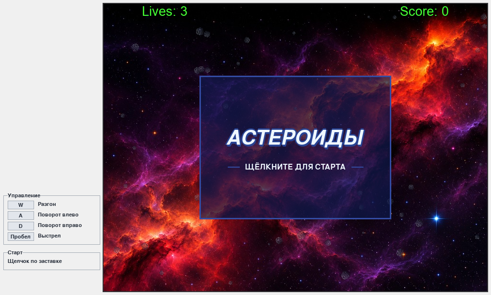
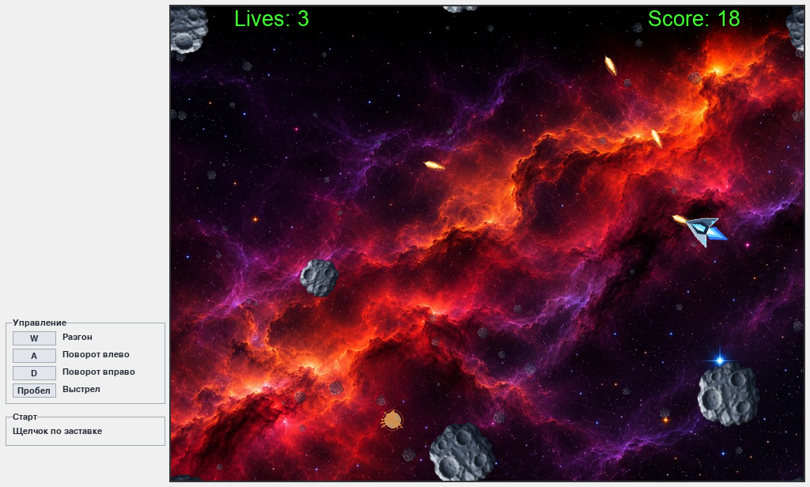

# Астероиды

**Автор:** Цхай Владислав  
**Группа:** ПИ25-2  
**Дисциплина:** Практикум по программированию  
**Дата сдачи:** не указана

## Описание проекта

«Астероиды» — двумерная аркада на Python и Pygame. Игрок управляет
кораблём и набирает очки, уничтожая астероиды. Поле замкнуто по обеим
осям: объект, пересёкший границу, появляется с противоположной стороны.

## Функциональные возможности

- Старт по щелчку на центральной заставке. Подсказки слева от поля.
- Вращение корабля, разгон с включённым двигателем и плавное торможение.
- Астероиды со случайным положением, скоростью и вращением.
- Ракеты, которые вылетают из носа и исчезают по истечении времени полёта.
- Покадровые взрывы, подсчёт очков и жизней, повторный запуск после раунда.
- Неподвижный космический фон и слой полупрозрачных астероидов,
  движущийся влево с постоянной скоростью.

## Демонстрация





## Требования к системе

- Python 3.10–3.13 с модулем `venv` и `pip`.
- Pygame 2.6.1, указан в `requirements.txt`.
- Windows, macOS или Linux с графическим рабочим столом.
- Git для клонирования репозитория.

## Установка и запуск

1. Клонируйте репозиторий и откройте папку проекта.

   ```bash
   git clone https://github.com/icebergfire/asteroids.git
   cd asteroids
   ```

2. Создайте и активируйте виртуальное окружение.

   Windows (командная строка)

   ```bat
   py -m venv venv
   venv\Scripts\activate.bat
   ```

   macOS или Linux

   ```bash
   python3 -m venv venv
   source venv/bin/activate
   ```

3. Установите зависимости.

   ```bash
   python -m pip install -r requirements.txt
   ```

4. Запустите игру.

   ```bash
   python main.py
   ```

### Управление

| Клавиша или действие | Результат |
| --- | --- |
| Щелчок левой кнопкой внутри заставки | Начать новый раунд |
| `A` | Повернуть корабль влево |
| `D` | Повернуть корабль вправо |
| `W` | Включить двигатель и разогнаться |
| `Пробел` | Стрелять в направлении носа корабля |
| `Esc` | Закрыть игру |

При русской раскладке используются те же физические клавиши `Ф`, `В` и `Ц`
для поворота влево, поворота вправо и разгона соответственно.

## Структура проекта

```text
asteroids/
├── main.py             # Окно, главный цикл и обработка событий
├── game.py             # Модель объектов, физика и правила игры
├── graphics.py         # Фон, спрайты, атлас взрывов и интерфейс
├── assets/
│   ├── nebula.jpg      # Неподвижный фон
│   └── asteroid.png    # Спрайт астероида
├── screenshots/
│   ├── start.png
│   └── game.png
├── requirements.txt
├── .gitignore
└── README.md
```

Три модуля разделяют ввод, правила и отрисовку. Физика использует
фиксированный шаг времени, а отрисовка читает состояние игры.
Параметры движения и столкновений собраны в начале `game.py`.

## Пример использования

Откройте игру и щёлкните по синей заставке. Клавишами `A` и `D` поверните
корабль к астероиду и нажмите пробел. При попадании появится взрыв,
а счёт увеличится на одно очко. При столкновении с астероидом корабль
возродится в центре, а запас жизней уменьшится. Столкновение при нулевом
запасе завершит раунд.
Счёт останется на экране до запуска следующего раунда.
